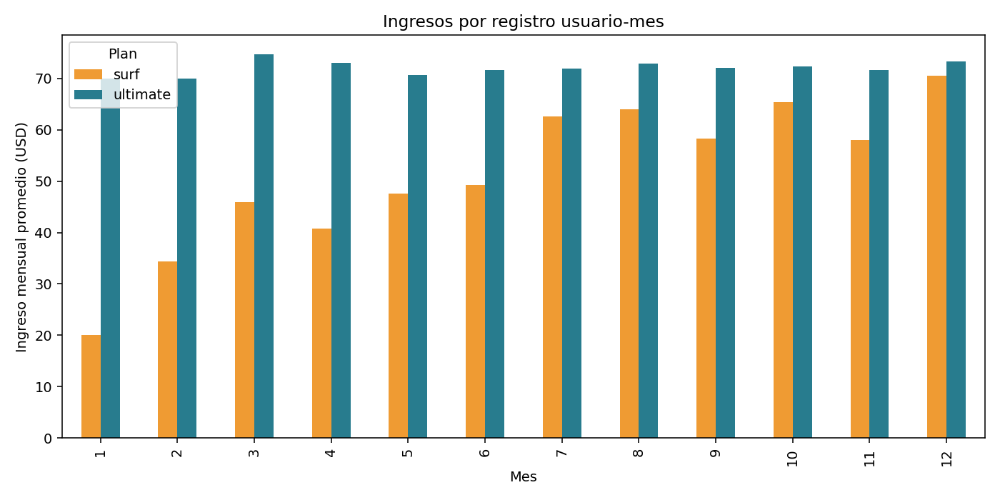

# Análisis estadístico de tarifas telefónicas

## Resumen

Comparé los planes **Surf y Ultimate de Megaline** para entender cómo cambia el consumo de llamadas, mensajes e internet y cuánto ingreso mensual genera cada uno. Este proyecto forma parte del **Sprint 5 del bootcamp de Data Science de TripleTen**.

**Autor:** [Luis Eduardo Aguilar Castellanos](https://github.com/EdAgZer03)
**Tecnologías:** Python · pandas · NumPy · SciPy · Matplotlib · Seaborn · Jupyter Notebook

## Objetivo

Analizar las diferencias de consumo e ingresos entre ambos planes y encontrar oportunidades para mejorar la oferta comercial. Trabajé con una muestra histórica de **500 usuarios**; 490 aparecen en los registros de consumo y generan **2,293 observaciones usuario-mes**.

## Qué hice

- Revisé y uní cinco archivos: usuarios, planes, llamadas, mensajes e internet.
- Convertí las fechas y agrupé el consumo por usuario y mes.
- Redondeé cada llamada al minuto superior y el consumo mensual de internet al GB superior, según las reglas del ejercicio.
- Calculé la tarifa base y los cargos por excedentes.
- Comparé las distribuciones con histogramas, diagramas de caja y pruebas de hipótesis.

## Resultados

| Indicador | Surf | Ultimate |
|---|---:|---:|
| Usuarios con registros de consumo | 333 | 157 |
| Observaciones usuario-mes | 1,573 | 720 |
| Ingreso promedio por observación mensual | 60.71 USD | 72.31 USD |
| Ingreso total en la muestra | 95,491.18 USD | 52,066.00 USD |

Ultimate genera un ingreso promedio mensual mayor. Surf tiene más observaciones y más variación por excedentes; por eso su ingreso acumulado es mayor en esta muestra. **El total facturado depende también del número de usuarios y meses observados**, así que no basta para decidir qué plan conviene más.

Los excedentes de internet aportan **62,466.00 USD** del total de **147,557.18 USD** facturado en ambos planes. Por eso revisaría una opción intermedia para quienes superan su paquete de datos con frecuencia.



## Pruebas de hipótesis

Usé pruebas bilaterales de **Welch**, con significancia de **0.05**. Calculé primero el ingreso mensual promedio de cada usuario para evitar contar sus distintos meses como observaciones independientes. La tabla anterior resume observaciones mensuales; las pruebas usan un valor por usuario.

| Comparación | Valor p | Conclusión con α = 0.05 |
|---|---:|---|
| Surf frente a Ultimate | 5.72e-08 | Rechacé la igualdad de medias. |
| Regiones `NY-NJ-PA` o `NY` frente al resto | 0.563 | No encontré evidencia suficiente para rechazar la igualdad de medias. |

No rechazar una hipótesis no demuestra que los grupos sean iguales. Los planes no fueron asignados aleatoriamente y los usuarios tienen distintos períodos de observación.

## Archivos del proyecto

- [Notebook](Notebooks/EDA.ipynb): análisis, gráficos y conclusiones.
- [Resumen por plan](reports/plan_summary.csv) y [resultados completos](reports/metrics.json).
- [Datos de entrada](data/README.md): archivos necesarios y configuración.

## Cómo ejecutar

Entorno de referencia: **Python 3.9.23 · TripleTen Legacy · Windows**. Consulta [requirements.txt](requirements.txt) para las bibliotecas principales y [requirements-lock.txt](requirements-lock.txt) para sus dependencias.

```powershell
python -m venv .venv
.venv\Scripts\Activate.ps1
python -m pip install -r requirements-lock.txt
$env:MEGALINE_DATA_DIR = 'C:\datos\megaline'
python scripts/execute_notebook.py
```

También puedes abrir `Notebooks/EDA.ipynb` en Jupyter con el mismo entorno. La variable `MEGALINE_DATA_DIR` debe apuntar a la carpeta con los cinco CSV; si no la defines, el script busca en `data/`.

## Conclusión y alcance

Lo más importante fue separar el consumo, la tarifa base y los excedentes antes de comparar ingresos. La propuesta de un plan intermedio necesita una evaluación comercial adicional.

El análisis incluye meses con al menos un registro de uso; no reconstruye los meses completamente inactivos. Los datos no incluyen costos, por lo que **ingreso no equivale a rentabilidad**. El comportamiento de esta muestra histórica tampoco garantiza el de otros clientes o períodos.
